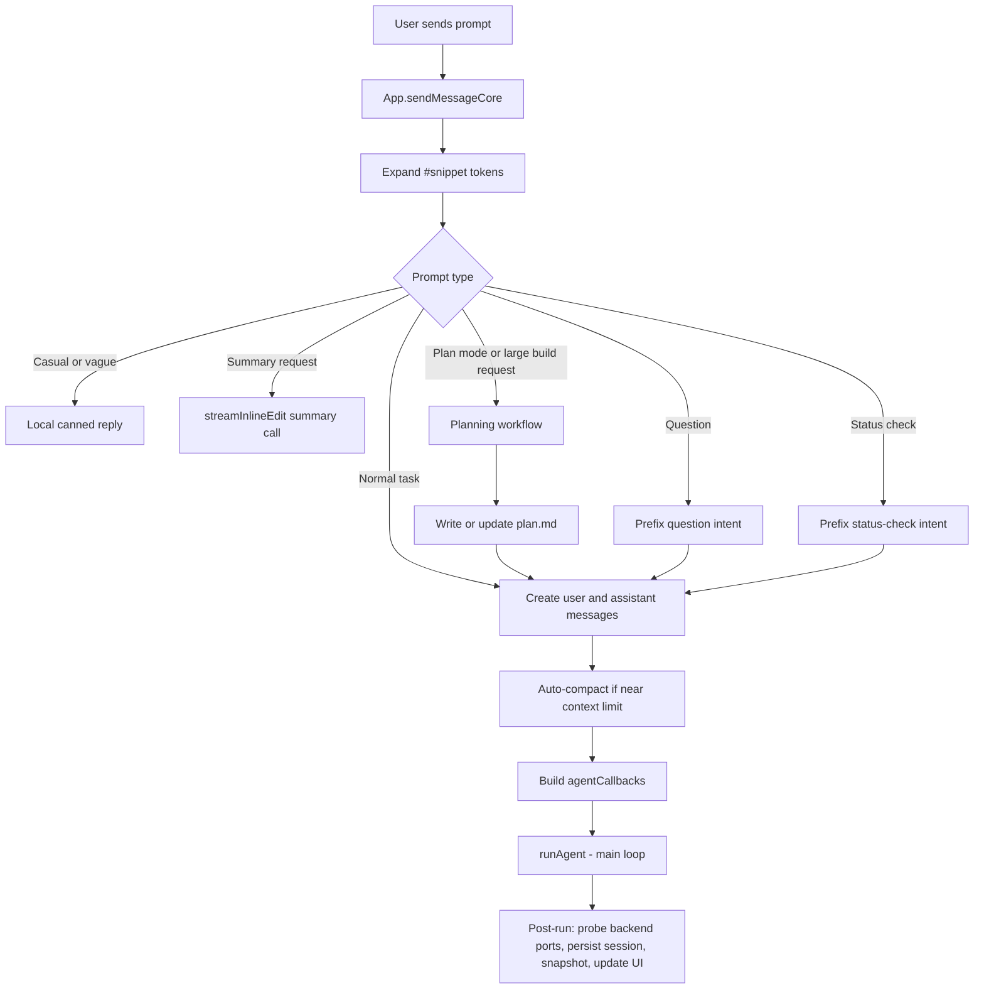
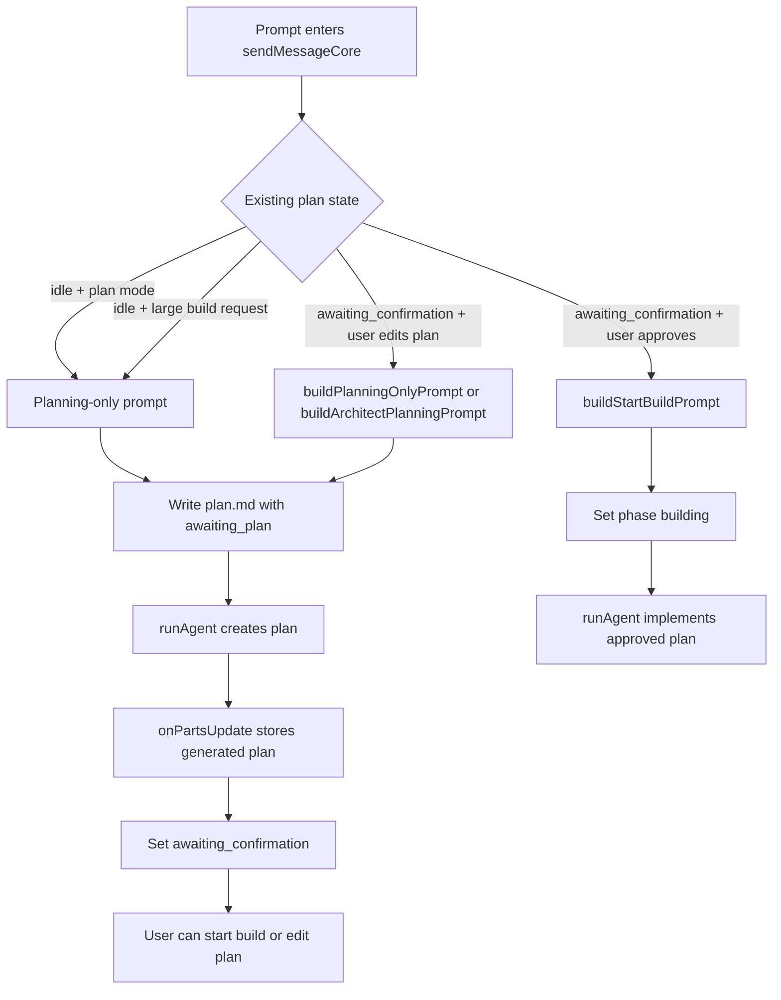
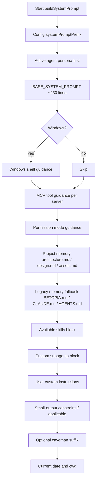
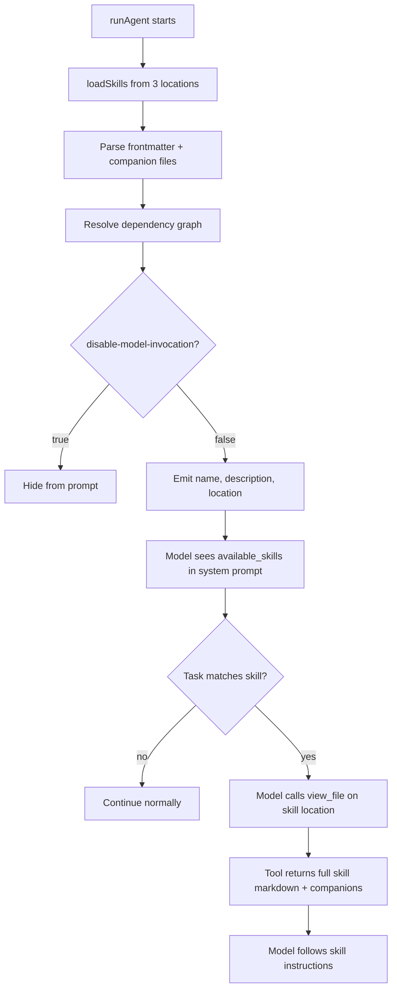
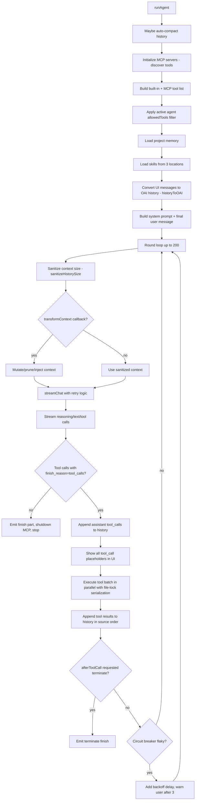
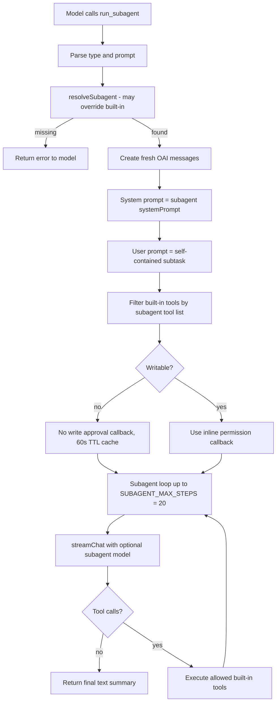
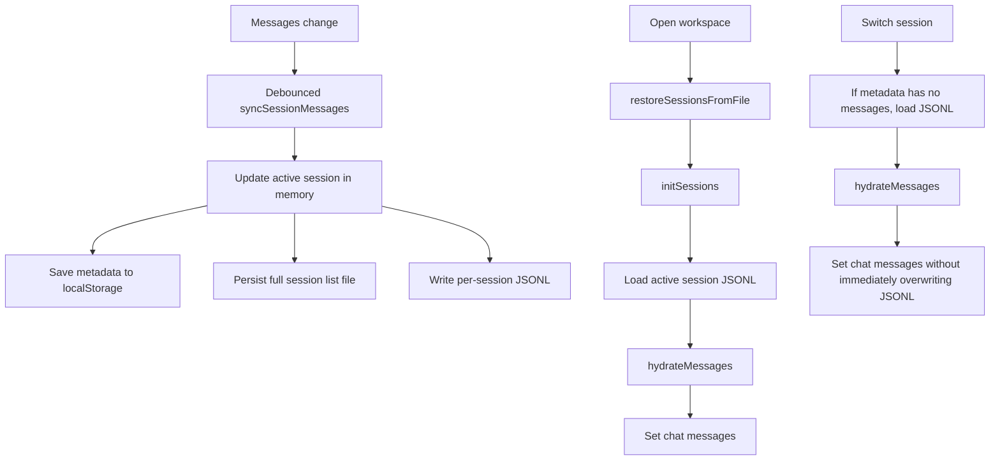

# Betopia Agent Workflow

This document describes how the Betopia desktop agent works from the moment a
user sends a prompt until the agent streams text, calls tools, loads skills,
spawns subagents, updates files, and persists the conversation.

Last verified against the current codebase on 2026-07-09.

## Source Map

| Area | Main files |
|---|---|
| Chat entrypoint and UI state wiring | `desktop/src/App.tsx` |
| Agent loop, tools, skills, subagents, provider streaming | `desktop/src/lib/agent.ts` |
| Built-in agent personas and tool restrictions | `desktop/src/lib/agents.ts` |
| Subagent definitions and custom subagent resolution | `desktop/src/lib/subagents.ts` |
| Subagent builder and repo import | `desktop/src/lib/subagent-builder.ts` |
| System prompt assembly | `desktop/src/lib/agent-prompts.ts` |
| Tool schemas and built-in tool implementations | `desktop/src/lib/agent-tools.ts` |
| Agent callback types | `desktop/src/lib/agent-types.ts` |
| History compaction and sanitization | `desktop/src/lib/agent-history.ts` |
| Project memory loading and skills loading | `desktop/src/lib/agent-project.ts` |
| MCP server manager (stdio/HTTP/SSE) | `desktop/src/lib/mcp-manager.ts` |
| MCP presets (Figma, Brave, Puppeteer) | `desktop/src/lib/mcp-presets.ts` |
| Stdio MCP wrapper | `desktop/src/lib/mcp-stdio-wrapper.ts` |
| Built-in skills (slash commands) | `desktop/src/lib/builtin-skills.ts` |
| Agent notifications routing | `desktop/src/lib/agentNotify.ts` |
| Agent config (model, MCP, behavior, sandbox) | `desktop/src/lib/config.ts` |
| Session metadata and JSONL message persistence | `desktop/src/store/sessionStore.ts` |
| App mode state: permission mode and effort | `desktop/src/store/appStore.ts` |
| Agent selection and custom agents store | `desktop/src/store/agentsStore.ts` |
| Agent session tracking and notifications store | `desktop/src/store/agentStore.ts` |
| Managed (Claude Code) agents store | `desktop/src/store/managedAgentsStore.ts` |
| Local persistence helpers | `desktop/src/lib/persist.ts` |

## High-Level Flow



## Chat Entrypoint

`sendMessageCore` in `App.tsx` is the entrypoint for normal chat, landing-page
prompts, plan-confirmation prompts, image/file attachments, retries, and
managed agent delegation.

Before the agent runs, the app:

1. Rejects empty prompts and concurrent sends while the agent is busy.
2. Expands `#snippet` tokens from the snippets store.
3. Classifies the prompt:
   - casual/vague messages get a local reply without an API call;
   - direct questions get an intent prefix telling the agent to answer directly;
   - summary requests use `streamInlineEdit` over conversation text;
   - status checks get an intent prefix asking for verification instead of code generation;
   - plan mode and larger build prompts enter the planning workflow.
4. Auto-compacts context if usage is near the configured model window.
5. Creates a user message and an empty assistant message.
6. Builds `agentCallbacks`, including UI streaming, approvals, file refresh,
   usage tracking, server preview hooks, and compaction hooks.
7. Calls `runAgent`. After it completes, probes backend ports to populate API docs pane.

## Planning Workflow

Planning is driven from `App.tsx`, before the normal agent loop starts.



Plan mode does not create a separate runtime. It changes prompt routing and
system instructions so new implementation requests produce a plan before edits.
When the user approves the plan, the same agent loop runs with an implementation
prompt and the normal approval gates remain active. The `update_plan` tool also
allows the agent to maintain a live checklist during implementation.

## Agent Selection

The active agent comes from the agent switcher (`desktop/src/store/agentsStore.ts`):

- **5 built-in agents** defined in `desktop/src/lib/agents.ts`;
- **Custom agents** stored in the agents store (persisted to localStorage);
- Each agent specifies: `id`, `name`, `description`, `instructions` (system
  prompt persona), `icon`, `allowedTools?` (tool whitelist), `model?` (optional
  model override).

Built-in agents:

| ID | Name | Allowed Tools | Model Override |
|---|---|---|---|
| `builtin:coder` | Coder | All tools | optional |
| `builtin:architect` | Architect | READ_TOOLS + write_file (plan.md only) | optional |
| `builtin:inline-reviewer` | Code Fixer | READ_TOOLS + write_file, edit | optional |
| `builtin:reviewer` | Code Reviewer | All tools | optional |
| `builtin:security` | Security | READ_TOOLS + edit | optional |
| `builtin:designer` | Designer | READ_TOOLS + write_file | optional |

`READ_TOOLS` includes: `view_file`, `list_files`, `list_dir`, `read_files`,
`project_structure`, `read_with_deps`, `grep_search`, `web_fetch`,
`run_subagent`.

At runtime, `runAgent` builds the available tool list as:

```text
BUILTIN_TOOLS + MCP tools (from enabled MCP servers)
```

Then it filters that list with `agentAllowedTools` if the active agent restricts
tools. This is enforced in code, not only by prompt text.

## System Prompt Construction

`buildSystemPrompt` (`desktop/src/lib/agent-prompts.ts`) creates the system prompt for each agent run.



Important ordering:

- The active agent persona is placed before the base prompt so role constraints
  take precedence.
- `BASE_SYSTEM_PROMPT` (~230 lines) covers: intent detection (8 classes with
  few-shot), coding rules (batch writing, project structure, React/CSS rules),
  MCP guidance, Figma design-to-code workflow.
- Skills are shown as metadata only, inside `<available_skills>`.
- Custom subagents are listed so the model knows which ids it can pass to
  `run_subagent`.
- The small-output constraint instructs models with limited output to produce
  skeleton-first code.
- The current date and project path are appended at the end.

## Skill Loading And Invocation

Skills are loaded in `agent.ts` from three locations:

1. System skills: `~/.codex/skills/.system/`
2. Project skills: `<project>/.betopia/skills/` (override duplicates by name)
3. User skills: `~/.betopia/skills/` (lowest priority)

Additionally, built-in skills are defined at `desktop/src/Skills/*/SKILL.md`
and registered in `desktop/src/lib/builtin-skills.ts`. These provide slash
commands (e.g., `/caveman`) and inline activation context.

Each skill uses YAML frontmatter:

```yaml
---
name: example-skill
description: When to use this skill
disable-model-invocation: false
depends-on: ["other-skill"]
---
```

The model does not call a skill as an executable tool. Instead:

1. `loadSkills(projectPath)` reads skill metadata and caches it briefly (30s TTL).
2. Companion files (`.md` files in the same folder) are merged into the skill body.
3. Dependency resolution with cycle detection runs before injection.
4. `buildSystemPrompt` inserts visible skills into `<available_skills>`.
5. The model decides whether a skill matches the task.
6. The model calls `view_file` on the skill `location`.
7. The skill body becomes tool output in the next LLM turn.
8. The model follows the skill instructions.



## Core Agent Loop

`runAgent` (`desktop/src/lib/agent.ts`) is the main loop. It runs up to
`DEFAULT_AGENT_MAX_ROUNDS` (200) rounds. A round is one model call plus any
tool batch produced by that call.



Retry behavior in `streamChat`:
- On 502/inference errors: trim context aggressively and retry.
- On output overflow: switch to small-output mode (skeleton-first workflow).
- On network errors: retry with 2s/4s exponential backoff (up to 3 attempts).
- If the tool tier fails, fall back to non-streaming, then to non-streaming
  without tools.

## Provider Request Flow

`streamChat` sends the OpenAI-compatible `/chat/completions` request through the
Tauri HTTP proxy (`desktop/src-tauri/src/net.rs`).

Request behavior:

- resolves provider endpoint and API key;
- applies active agent model override if present (per-agent model selection);
- injects Anthropic-style prompt caching for compatible models;
- maps Effort (`low`, `medium`, `high`) to `thinking_budget_tokens` or
  `reasoning_effort`;
- sends tools with `tool_choice: auto`;
- tries capability tiers in order:
  1. streaming with tools;
  2. non-streaming with tools if the backend fails with a 5xx;
  3. non-streaming without tools if the tool tier also fails.

The response parser supports:

- true SSE streaming;
- JSON bodies returned despite `stream: true`;
- non-streaming JSON responses;
- reasoning content;
- `<think>...</think>` blocks;
- streamed partial tool-call arguments;
- usage token accounting.

## Tool Execution

Built-in tools (`desktop/src/lib/agent-tools.ts`, 22 tools):

| Group | Tools |
|---|---|
| File mutation | `write_file`, `edit`, `delete_file`, `rename_file` |
| File reading | `view_file`, `read_files`, `read_with_deps`, `list_files`, `list_dir`, `project_structure`, `grep_search` |
| Shell | `bash` (with `run_in_background` and `timeout` support) |
| Subagents | `run_subagent`, `run_subagents` (parallel), `run_subagent_chain` (sequential) |
| Memory & planning | `update_memory` (`.betopia/memory.md`), `update_plan` (live checklist) |
| Managed terminal agent | `spawn_coding_agent`, `send_to_agent`, `read_agent_output` |
| External data | `web_fetch` (URLs and local file paths) |
| MCP interaction | `mcp_list_resources`, `mcp_read_resource` |

MCP tools from configured servers are merged into the tool list with
`${serverName}__${toolName}` naming and filtered by `agentAllowedTools`. A
read-only heuristic classifies MCP tools by verb prefix (create/update/delete
are write verbs; get/list/search are read verbs).

Tool batch behavior:

```mermaid
sequenceDiagram
  participant LLM as Model
  participant Loop as runAgent
  participant UI as Chat UI
  participant Tool as Tool Executor
  participant Hist as OAI History

  LLM->>Loop: assistant response with tool_calls
  Loop->>Hist: append assistant tool_calls
  Loop->>UI: show all tool_call placeholders
  par each tool call
    Loop->>Loop: beforeToolCall hook + arg validation
    Loop->>UI: approval_request if needed
    UI-->>Loop: approved or rejected
    Loop->>Tool: execute built-in, MCP, or subagent
    Tool-->>Loop: result text
    Loop->>Loop: afterToolCall hook + audit log
    Loop->>UI: tool_result as soon as done
  end
  Loop->>Hist: append tool results in source order
  Loop->>LLM: next round with ordered tool results
```

Parallelism rules:

- tool calls from one model response run concurrently;
- UI results appear in completion order;
- history results are committed in original source order because the API expects
  tool results to match the assistant tool-call order;
- file mutations to the same path are serialized with an in-round file lock
  (`withFileLock`);
- different files and read-only tools may run in parallel.

Tool hooks:

- `beforeToolCall` can block execution, rewrite JSON arguments, or request
  approval. Includes schema validation against the tool's JSON schema.
- `afterToolCall` can replace the result, flip error state, log audit events,
  or terminate the loop.
- `transformContext` can alter the model context before each LLM call.

## Permission And Approval Modes

Permission mode is stored in `appStore` and passed into `runAgent`.

| Mode | Behavior |
|---|---|
| `default` | File writes/edits and mutating bash wait for explicit user approval. |
| `plan_mode` | New implementation prompts produce a plan first; edits still require approval. |
| `auto_review` | File diffs and bash approval cards are shown but auto-approved. |
| `full_access` | Tools proceed without blocking for approval. |

Approval paths:

- `write_file` and `edit` create an `approval_request` containing original and
  proposed content for the diff UI.
- `edit` previews use the same multi-edit applier as execution, so `edits[]`
  and legacy `old_string`/`new_string` behave consistently.
- `bash` skips approval for commands classified as read-only. Mutating commands
  require approval unless mode is `auto_review` or `full_access`.
- Writable subagents use the inline permission callback for their own file and
  bash operations.

## Subagent System

Built-in subagents are defined in `desktop/src/lib/subagents.ts`.

| Subagent | Writable | Purpose |
|---|---|---|
| `explore` | no | Read-only codebase exploration. |
| `code-review` | no | Actionable correctness, architecture, performance, security findings. |
| `security` | no | Security audit for trust-boundary risks. |
| `general` | no | General multi-file research. |
| `coder` | yes | Scoped implementation work. |
| `fixer` | yes | Minimal bug fix. |

Custom subagents are defined from Settings and resolved by `resolveSubagent`.
The `CustomSubagentDef` type supports:
- `id`, `label`, `description`, `systemPrompt`
- `writable` (enables write tools)
- `model` (optional per-subagent model override)
- `tools` (explicit tool whitelist)
- `sourceType` (`'manual' | 'repo'`)
- Import fields: `sourceUrl`, `sourcePath`, `linkedSkills`, `importNotes`,
  `manifestsDetected`

If a custom subagent has an explicit `tools` list, the resolver filters it
against known write/read tools. Otherwise, the `writable` flag chooses either
the read-only tool set (`READ_ONLY_TOOLS`: 8 tools) or the write-capable tool
set (`WRITE_TOOLS`: 13 tools).



Subagent tool variants:

- `run_subagent`: one isolated subagent, returns a text summary.
- `run_subagents`: independent tasks run in parallel with `Promise.all`.
- `run_subagent_chain`: steps run sequentially; `{previous}` in a later prompt
  is replaced by the prior step output.

Subagents have fresh context. The caller must include all relevant details in
the subagent prompt. Subagents **cannot spawn other subagents** (blocked with
error). Read-only subagents have a 60-second TTL cache keyed by (type + prompt).

### Subagent Builder & Repo Import

`desktop/src/lib/subagent-builder.ts` allows importing subagents from GitHub:

- **`RepoSubagentTrustLevel`**: `'low' | 'medium' | 'high'` — controls whether
  write tools are enabled. Only `'high'` allows writable subagents.
- **`createDraftSubagentFromImportedRepo()`**: Creates a `DraftSubagent` from a
  repo import candidate.
- **`validateDraftSubagent()`**: Validates a draft against existing subagents,
  skills, and security scanning.
- **`buildImportedSubagentSystemPrompt()`**: Generates a safety-wrapped system
  prompt with trust guidance.
- **`scanSubagentPromptSecurity()`**: Scans for prompt injection, destructive
  commands, pipe-to-shell, credential exposure, and destructive database patterns.

## MCP Server Integration

The `MCPManager` (`desktop/src/lib/mcp-manager.ts`) supports 3 transport types:

| Type | Usage | Init |
|---|---|---|
| `stdio` | Local processes (npx, node, python) | MCP initialize handshake |
| `http` / `json` | HTTP-based servers | Direct API call |
| `sse` | Server-Sent Events streaming | SSE connect → endpoint event → initialize |

Features:
- Per-server tool blocklist (`disabledTools`)
- Keepalive pings every 30s
- Auto-reconnection on disconnect
- `testMCPServer()` — standalone connectivity validator
- Resource listing/reading, prompt listing/getting
- Bidirectional JSON-RPC support (responds to `roots/list` from servers)
- Configurable timeouts (per-server)
- MCP presets: Figma, Brave Search, Puppeteer with env key templates

## Session Persistence

The UI message list lives in `chatStore`, while sessions are managed by
`sessionStore`.



Important details:

- localStorage stores only session metadata to avoid quota failures;
- full message history is written to `appDataDir/sessions/<session-id>.jsonl`;
- session hydration skips the next automatic sync so metadata-only sessions do
  not overwrite JSONL with empty arrays;
- branch sessions copy messages up to the chosen point and write a new JSONL
  file.

## Memory And Context Management

Project memory is loaded before each agent run via `desktop/src/lib/agent-project.ts`.

Primary files (checked first):
1. `architecture.md`
2. `design.md`
3. `assets.md`

Legacy fallback files (checked if primary files are missing):
1. `BETOPIA.md`
2. `betopia.md`
3. `CLAUDE.md`
4. `AGENTS.md`
5. `.betopia/memory.md`

Behavior:
- 30-second cache TTL per load.
- Max 32KB per load, split evenly among primary files.
- `invalidateMemoryCache()` clears on memory writes.
- `update_memory` tool writes/appends to `.betopia/memory.md` and clears cache.

Context protection happens at several levels:

- `sendMessageCore` may compact before starting if usage is near the threshold;
- `runAgent` may compact old history using `compactHistory` (structured summary
  with Goal, Constraints, Progress, Key Decisions, Next Steps, Critical Context);
- each LLM round sanitizes history with `sanitizeHistorySize` (trim to 75% of
  context window, cap tool results at 2K chars);
- `trimInferenceContext` aggressively removes middle messages on inference
  failure, keeping first + last 6 messages;
- tool results stored in history are capped separately from UI display text;
- inference failures retry after trimming context;
- context-overflow errors ask the user to compact if retries cannot recover.

## What The Model Sees Each Round

The model receives:

1. one system prompt built from persona, base rules, memory, skills, MCP tools,
   custom subagents, custom instructions, date, and cwd;
2. converted chat history from UI messages (up to `HISTORY_MAX_MESSAGES` = 60);
3. tool result messages from previous rounds;
4. the current user prompt, including image blocks when present;
5. the active tool schema list, filtered by agent permissions and supplemented
   with MCP tools.

The model does not directly see React state, the file tree store, or all config.
It only sees what the prompt, history, and tools expose.

## Managed Agents (Claude Code)

The agent loop supports spawning a terminal-based Claude Code agent via three
tools:

| Tool | Purpose |
|---|---|
| `spawn_coding_agent` | Spawns Claude Code in a PTY terminal, registers in `useManagedAgentsStore` |
| `send_to_agent` | Sends follow-up instructions to the spawned agent |
| `read_agent_output` | Reads trailing lines from the agent terminal |

Managed agents are tracked in `managedAgentsStore` with fields: `sessionId`,
`terminalSessionId`, `task`, `rounds`, `maxRounds` (default 3), `phase`
('spawning' | 'working' | 'reviewing' | 'done'), `reviewedAtRound`,
`pendingReview`.

## Agent Notifications

`desktop/src/lib/agentNotify.ts` routes notifications based on UI focus state:

- Shows in-app toast for background agent events (5s duration).
- 3 notification kinds: `attention`, `finished`, `error`.
- `NotificationBell` component (`desktop/src/modules/agents/components/`):
  dropdown showing active sessions + notification history with relative
  timestamps.

## Config Persistence

Agent config (`desktop/src/lib/config.ts`) is stored in `localStorage` (key:
`betopia_agent_config`) with file fallback.

```typescript
{
  model: ModelConfig       // providerId, model, apiKeys, customBaseUrl, temperature
  mcpServers: MCPServer[]  // MCP server configurations
  behavior: BehaviorConfig // caveman mode, yoloMode, autoCompact
  sandbox: SandboxConfig   // Docker sandbox settings
  customSubagents: CustomSubagentDef[]
}
```

API keys are dual-stored: localStorage (primary) + OS keychain (secondary via
Tauri `secrets_get/set`). Old single-key `betopia_ai_config` is auto-migrated.

## Safety Boundaries

Current guardrails are:

- per-agent tool whitelists enforced in code;
- approval gates for edits and mutating bash;
- read-only bash detection;
- same-file mutation serialization (`withFileLock`);
- project-root file tools through Tauri/Rust helpers (`desktop/src-tauri/src/modules/fs/`);
- model context trimming and compaction;
- no hidden execution of skills; skills must be read through `view_file`;
- custom subagents are constrained to known tool names;
- prompt injection scanning for imported subagents (`scanSubagentPromptSecurity`);
- path traversal protection in file tools;
- argument schema validation against each tool's JSON schema;
- sensitive key redaction in audit logs.
